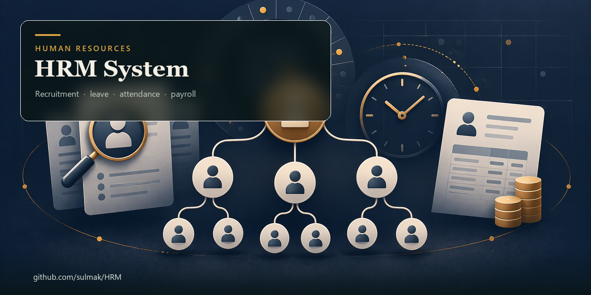

  
  <h1>Md. Atikur Rahman Mridha</h1>
  <h3>Full-stack developer · .NET &amp; Angular</h3>
  
I build business software that keeps the books balanced, the people paid, and the shelves in order.

  

    
    
    
  

---

### Selected work

<table>
  <tr>
    <td width="46%" valign="top">
      
    </td>
    <td valign="top">
      <h3>Ledgerline — Accounting System</h3>
      
A double-entry accounting system for small businesses: sales, expenses, inventory, payables and receivables, with every transaction posted to a balanced ledger.

      

        <code>ASP.NET Core 8</code> <code>EF Core</code> <code>SQL Server</code> <code>Angular 17</code>
      

      <ul>
        <li>Atomic double-entry posting rules</li>
        <li>Trial balance, income statement and general ledger</li>
        <li>PDF and Excel exports by fiscal period</li>
        <li>Budgets, dashboards and an admin panel</li>
      </ul>
      <a href="https://github.com/sulmak/AccountingSystem"><strong>View repository →</strong></a>
    </td>
  </tr>
  <tr>
    <td width="46%" valign="top">
      
    </td>
    <td valign="top">
      <h3>HRM System</h3>
      
An end-to-end HR platform covering recruitment, leave, attendance and payroll, with rules that reflect real company policy.

      

        <code>ASP.NET Core 8</code> <code>EF Core</code> <code>SQL Server</code> <code>Angular 18</code>
      

      <ul>
        <li>Recruitment pipeline from circular to joining</li>
        <li>Shift-aware attendance, overtime and late deductions</li>
        <li>Payroll with PF, tax, leave and payslip breakdowns</li>
        <li>Employee calendar, performance and device punch import</li>
      </ul>
      <a href="https://github.com/sulmak/HRM"><strong>View repository →</strong></a>
    </td>
  </tr>
  <tr>
    <td width="46%" valign="top">
      
    </td>
    <td valign="top">
      <h3>LibraryMS</h3>
      
A role-based library management system with catalog, issue and return, overdue fines and organization branding.

      

        <code>ASP.NET Core 8 MVC</code> <code>Identity</code> <code>EF Core</code> <code>SQLite</code>
      

      <ul>
        <li>Admin, librarian and member roles</li>
        <li>Loan periods, overdue warnings and fines</li>
        <li>Self-registration and profile management</li>
        <li>SQLite database with ASP.NET Core Identity</li>
      </ul>
      <a href="https://github.com/sulmak/LibraryMS"><strong>View repository →</strong></a>
    </td>
  </tr>
</table>

---

### Tools I work with

  
  
  
  
  
  
  

### About

Most business software succeeds or fails on details nobody demos: a balanced journal entry, a leave balance that respects the joining date, a payroll run that handles a mid-month shift change. I work across the whole stack — schema, backend rules, and the screens that make those rules understandable.

- **Backend:** C#, ASP.NET Core 8, EF Core, REST APIs, ASP.NET Core Identity
- **Frontend:** Angular 17/18, TypeScript, HTML, CSS, Bootstrap 5
- **Domain:** double-entry accounting, HR and payroll, inventory, reporting and PDF/Excel export
- **Data:** SQL Server, SQLite

---

  
Open to interesting .NET and Angular work — especially business tools with real rules.

  

    <a href="mailto:sulmak.mridha@gmail.com"><strong>sulmak.mridha@gmail.com</strong></a>
    &nbsp;·&nbsp;
    <a href="https://github.com/sulmak"><strong>github.com/sulmak</strong></a>
  

  
Designed &amp; built by Md. Atikur Rahman Mridha

